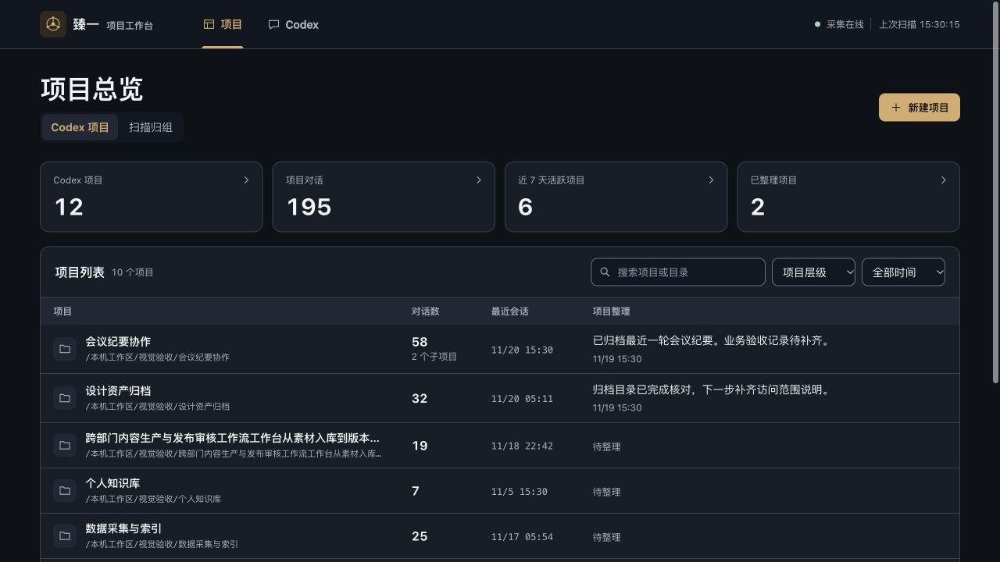

# 个人项目工作台

在 Mac 上查看 Codex 项目、对话和交付进展。首页显示项目活动和整理摘要。「扫描归组」支持从获准目录发现多个 Git 仓库及非 Git 项目。Codex 对话、工作台和项目进展都从同一个本地地址打开。



## 在 macOS 上运行

本机需要 Node.js 24 或更新版本以及 Git。Codex 功能需要安装并登录支持本机 App Server 接口的 Codex 桌面版。

```sh
git clone https://github.com/JokerMok/personal-project-workbench.git
cd personal-project-workbench
npm ci
npm run build
npm start
```

在 Codex 内置浏览器打开 [本地工作台](http://localhost:43127/)。用 `npm run status` 查看服务，用 `npm run stop` 停止服务，用 `npm run restart` 重启。关闭标签页或退出终端后，采集进程继续运行。Mac 重新开机后，可用 `npm start` 再次启动。

数据保存在 `~/Library/Application Support/个人项目工作台/`。

| 位置 | 用途 |
| --- | --- |
| `workspace.sqlite` | 授权目录、归组、里程碑、规则、采集快照、证据历史、Codex 项目整理的设置和摘要，以及工作台创建的 Codex 会话 ID 和来源。运行期间 SQLite 同时使用 WAL 伴随文件 |
| `receipts/<项目 ID>/*.json` | 项目级回执，文件名对应回执 ID |
| `service.json`、`service.log` | 本次服务的身份和诊断日志 |

## 从发现到交付

1. 在「新发现待确认」打开候选。Git 仓库按实际公共 Git 目录识别，同仓库的工作树列在一起。非 Git 目录也会出现在列表里。仅授权外置工作树时，若其公共 Git 目录在范围之外，会显示需要补充授权。
2. 点「确认项目归组」，核对目录、仓库与会话。可以将不同扫描根下的候选放进同一个项目，也可以归入已有项目。相同上级目录会产生建议，保存时才确认归属。
3. 写明本阶段交付物，选择用验收回执或部署回执完成阶段，填写必须校验的相对文件路径。可补充验收说明与下一步。默认在阻塞、需验收和证据冲突时提醒。明确请求决定的回执也会出现在「需要我处理」。
4. 日常直接看首页。详情保留关联目录、Git 分支与提交、会话 ID、证据文件和阶段变化。需要开启下一阶段时，在「调整项目与规则」修改里程碑或验收条件，旧回执继续留在历史中。

| 证据 | 工作台如何使用 |
| --- | --- |
| 会话索引时间 | 记录会话活动。服务读取已授权工作目录的会话 ID 和时间 |
| Git 提交、项目文件实际变化 | 更新最近实质变化。确认里程碑之后的新变化可推进到「进行中」 |
| 测试通过回执 | 记录该版本的验证结果 |
| 待验收回执 | 进入「待验收」 |
| 验收通过、部署完成回执 | 核对本阶段的交付条件和全部必需证据。只有复核通过的部署回执能显示「已上线」 |
| 阻塞、请求决定、已解决回执 | 更新独立标记，保留当前阶段 |

工作台在服务启动时扫描，文件变化约 0.5 秒后合并采集，持续变化时最多等 2.5 秒安排一轮。每 60 秒兜底，定时器因睡眠出现较长间隔时立即补扫。页面通过本机事件流刷新。「最近有变化」取最近七天的实质证据。目录不可用时会显示「数据过期」并保留上次可信记录。

普通项目文件按名称、大小和内容摘要观察。8 MiB 以内的文件缓存 SHA-256，同内容的时间戳变化不会推进阶段。更大的文件发生同大小改写时，记录「内容变化未核实」。证据回执引用的文件一律按完整内容校验。隐藏目录、常见构建产物、日志和会话 JSONL 不参与项目进展判断。

## 在工作台里和 Codex 对话

打开 [Codex 页](http://localhost:43127/#/codex)。可以按名称、目录或 ID 查找本机会话，也可以选定工作目录后点击「新对话」。发送用按钮或 ⌘↵，生成过程中可停止。工作台使用已安装的 Codex 和当前 ChatGPT 登录状态，实时显示回复。

「会话范围」只授权会话读取和对话的工作目录。勾选「包含子目录」才扩展范围。扫描目录中勾选了会话关联的目录也会出现在这里。列表读取本地索引中的 ID、会话名称、工作目录和时间。打开某条会话才读取该条文字历史。

在已有 Codex 会话里发送会接着原会话聊。通过「创建分支」可以从当前会话另开一条。正文保存在 Codex 自己的历史里。回复使用只读配置，Shell、连接器和项目写入均关闭。关闭页面后当前回复继续生成。停止工作台服务会结束进行中的回复，已保存的文字可在重新启动后查看。

## 项目状态与自动整理

「新建项目」把选定目录登记到本机 Codex。项目页显示含子项目的对话总数、直接归属数量、最近会话和整理结果。既有对话优先按 Codex 登记的项目归属计数，旧会话按已登记目录匹配。计数可使用项目元数据。打开文字历史仍以已授权的会话目录为准。

「浏览目录」逐层列出当前目录下的子目录。子目录可以登记为独立 Codex 项目，也可直接在它的工作目录里启动属于当前项目的新对话。「项目新增对话」会在选定目录创建并挂到指定项目。

「Codex 项目整理」可立即执行，也可对单个项目开关自动整理。需要定时运行时，可在 Codex 日程中把工作目录设为本仓库，并运行 `node local/review-trigger.mjs`。收到触发信号后，工作台检查启用的项目，并在证据有变化时更新摘要。若触发时服务处于停止状态，下次启动会读取已保存的信号。

摘要使用已授权的会话元数据、工作台确认的里程碑与证据。启用「参考最近获准的 Codex 回复」后，会采样最新三条获准会话中各最多两条近期回复。摘要单独保存并附可追溯的来源，待核实项和建议与已确认阶段分开。

## 让 Codex 产生回执

项目详情的「交付规则 → 项目级 Codex 回执约定」提供该项目的真实 ID、里程碑 ID、证据路径和可复制命令。把这段约定交给处理该项目的 Codex 任务即可。也可自行放进该项目的 AGENTS.md。工作台只在自身数据目录写回执。

从关联目录调用 `local/receipt.mjs`，传入项目、里程碑、结果、实际版本、证据文件与下一步。也可用已关联的 `--session` 代替 `--version`。多个证据分别传 `--proof`。工具计算 SHA-256 后原子写入回执，相同输入重试会返回同一份文件。若验收说明包含人工签收，出具回执的任务应先取得相应结论，并把它保存在约定的证据文件里。

其他本地工具也可产生下列格式的 JSON。将文件命名为 `<id>.json`，完整写好后再移入此项目的回执目录。以下值为格式示意。

```json
{
  "schemaVersion": 1,
  "id": "review-v1",
  "projectId": "<项目 ID>",
  "milestoneId": "<当前里程碑 ID>",
  "at": "<带时区的 ISO 8601 时间>",
  "version": "<提交哈希或实际制品版本>",
  "result": "accepted",
  "evidence": [
    { "path": "<关联目录内证据文件的绝对路径>", "sha256": "<64 位小写十六进制摘要>" }
  ],
  "next": "<下一步>"
}
```

`result` 支持 `progress`、`tests_passed`、`ready`、`accepted`、`deployed`、`blocked`、`decision` 和 `resolved`。回执文件应留存，引用的验证记录宜按版本保存。本阶段回执被改写、丢失、摘要不匹配或证据归属不符，都会提示复核。新的项目文件变化会更新变化记录，已确认的目标由用户维护。

## 本机边界与上游

本分支基于 repo-control 0.14.0 的提交 `35fff7bf3bd625e6e55905196f0227068a4eab45`。沿用目录遍历、受限并行读取、simple-git、原生目录选择器、Host 检查、项目表格组件和图标。原始版权声明见 [MIT 许可证](LICENSE)，原始代码可在[固定的上游提交](https://github.com/LorenzoVicino/repo-control/tree/35fff7bf3bd625e6e55905196f0227068a4eab45) 查看。

运行入口为 `local/server.mjs`，监听 `127.0.0.1`。提供工作台读取、事件流、目录选择、授权、归组，以及限定的 Codex 项目、对话和整理接口。Git 使用 Apple 自带的 `/usr/bin/git`，仅查询本地分支与提交。程序和页面资源都在本机。会话索引读取器先限制目录范围，再核对真实路径。打开历史前，工作台还会核对选中会话的历史文件路径。索引不可用时显示「未接通」。

会话列表和项目扫描在本机运行，对话使用官方 ChatGPT 服务。

## 开发验证

`npm test` 在临时目录运行测试，覆盖目录与会话读取边界、只读 Git、文件扫描、证据回执和状态流转。
